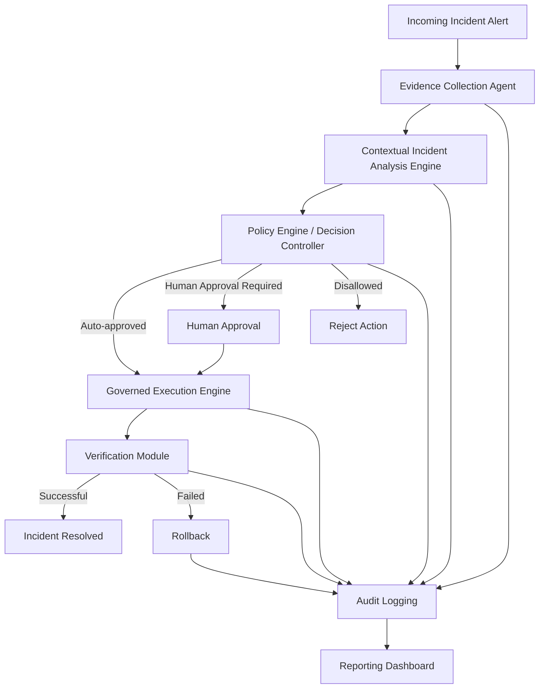

# Policy-Driven AI Framework for Autonomous Incident Response

## Project Overview

Modern cloud-native applications generate large volumes of logs, metrics and alerts. Identifying the root cause of incidents and deciding appropriate corrective actions manually can be time-consuming for on-call engineers.

The **Policy-Driven AI Framework for Autonomous Incident Response** aims to automate incident analysis and response through AI-assisted root cause analysis, configurable policy enforcement and governed execution.

The framework analyses incident evidence, recommends remediation actions and evaluates them against predefined policies before execution. It also supports human approval for high-risk actions, verification of recovery and rollback when verification fails.

## Objectives

- Automate the collection and correlation of incident evidence.
- Perform contextual Root Cause Analysis (RCA) using an LLM.
- Classify remediation actions based on configurable policies.
- Ensure controlled execution through predefined and permissioned operations.
- Support human approval for high-risk actions.
- Verify incident recovery and support rollback.
- Maintain audit logs for transparency and accountability.

## System Architecture

The framework follows a modular architecture in which each component performs a specific responsibility.

## Core Modules

| Module | Responsibility |
|---|---|
| Evidence Collection Agent | Collects application logs, system metrics, service health information and incident history. |
| Contextual Incident Analysis Engine | Uses an LLM through the OpenAI API to analyse evidence and identify probable root causes and remediation recommendations. |
| Policy Engine / Decision Controller | Evaluates proposed actions using configurable JSON policies and classifies them as auto-approved, requiring human approval or disallowed. |
| Governed Execution Engine | Executes only predefined and authorised service operations. |
| Verification and Rollback Module | Checks service health after execution and supports rollback if recovery verification fails. |
| Audit Logging and Reporting Dashboard | Records incident evidence, recommendations, policy decisions, approvals, execution events and verification results. |

## Technology Stack

| Component | Technology |
|---|---|
| Backend | Python 3.10+, FastAPI |
| Frontend | React.js, Vite |
| Database | SQLite |
| AI Integration | OpenAI API |
| Policy Configuration | JSON |
| Monitoring Inputs | Application logs and system metrics |
| Version Control | Git and GitHub |

## System Workflow

1. **Incident Detection:** An incoming alert initiates the incident response workflow.
2. **Evidence Collection:** The system gathers relevant logs, metrics, service health information and incident history.
3. **AI-Based Analysis:** The analysis engine examines the collected evidence and identifies probable root causes.
4. **Policy Evaluation:** The policy engine evaluates the recommended remediation action.
5. **Governed Execution:** Approved actions are passed to the execution engine. High-risk actions require human approval.
6. **Verification:** The system checks whether the remediation action has restored service health.
7. **Rollback and Auditing:** Failed verification triggers the rollback process, while incident activities are recorded for auditing.

## Setup and Usage

### Prerequisites

- Python 3.10 or later
- Node.js and npm
- Git
- OpenAI API key

### Configuration

1. Clone the repository.
2. Configure the Python backend environment.
3. Install the backend dependencies using the repository's dependency file.
4. Configure the OpenAI API key using environment variables.
5. Install the frontend dependencies.
6. Configure the SQLite database and JSON policy configuration.
7. Start the backend and frontend using the commands defined in their respective project configurations.

> **Note:** Add the exact installation commands, environment variable names and startup commands after confirming your repository's actual folder structure and configuration files.

## Expected Outcomes

The framework is designed to:

- Reduce manual effort in incident investigation.
- Improve the speed of root cause identification.
- Provide policy-controlled remediation decisions.
- Reduce the risks associated with unrestricted automated execution.
- Improve incident traceability through audit logging.
- Support reliable recovery through verification and rollback.

Quantitative performance improvements such as Mean Time to Resolution (MTTR) reduction should be added only after actual testing and measurement.

## Future Enhancements

- Integration with Prometheus and Grafana for external observability.
- Slack and Microsoft Teams integration for ChatOps-based approvals.
- Expansion of the predefined remediation action library.
- Advanced policy validation mechanisms.
- Feedback-driven runbook improvements.
- Policy tuning based on historical incident outcomes.

## Technical Reflection

One of the major technical challenges addressed in this project is balancing AI-driven incident analysis with safe and controlled automated execution. Although an LLM can analyse logs and recommend possible remediation actions, allowing it to execute arbitrary commands directly can introduce operational risks. To address this, the framework separates contextual incident analysis from policy evaluation and execution. The Policy Engine acts as a decision-making layer that classifies proposed actions according to predefined rules, risk levels and approval requirements. This modular approach makes the response process more controlled and transparent. Another important consideration is verifying whether an executed action actually resolves the incident rather than assuming that execution indicates success. The verification and rollback modules address this requirement. Working on this architecture strengthened my understanding of AI-assisted automation, backend design, policy enforcement and reliability in cloud-native systems.

## Project Team

- **Mushafina R**
- **Sri Yaline R**
- **Pragathi Kumar**

**Team No.:** 034

**Project Guide:** Dr. Karthika R N  
Assistant Professor, Department of Information Technology  
Saveetha Engineering College

---

*Academic Mini Project – 2026–2027*
